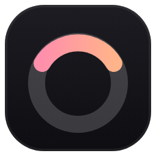

# Brim

**A cleaner Windows desktop.** Brim adds a notch at the top of your screen (music, shortcuts, games, messages, notes and more), an optional dock that replaces the taskbar, desktop widgets and live wallpapers.

Works on Windows 10 (version 2004 or newer) and Windows 11. No admin rights needed, and nothing else to install.

---

## Install

1. Go to the [**Releases**](../../releases/latest) page and download **`Brim-x.y.z-Setup.exe`** (about 90 MB).
2. Double-click it.
3. **"Windows protected your PC"?** Brim isn't signed with a paid certificate, so Windows warns about new downloads. Click **More info**, then **Run anyway**.
4. Click **Yes** to install. Brim installs just for you (into `%LOCALAPPDATA%\Programs\Brim`), adds itself to the Start menu and starts up.
5. The first launch takes a few seconds while it unpacks itself and Windows Defender checks it. After that it starts almost instantly.

Settings open on the first run so you can pick what you want. Nothing about your taskbar or desktop changes until you choose it.

**Start with Windows:** Settings › General › *Start Brim with Windows*.

### Update

Brim updates itself in the background, like other apps. When you turn on your PC it checks straight away and installs a new version within the first few minutes; later in the day it waits until you've been away from the PC for a few minutes. It never restarts during a fullscreen game or video, and the notch says *"Brim updated"* afterwards. To be asked first instead, turn off **Install updates by themselves** in **Settings › General › Updates** (you can also check now or turn updates off there). Your settings, notes and widgets are always kept.

On 0.6.0–0.6.5, the notch asks once (*"Brim x is ready"*, click it); from 0.6.6 on, updates install by themselves.

Coming from 0.5.x? Download the newest `Setup.exe` once and run it (click **Yes** to update); after that, updates come by themselves.

### Uninstall

Windows **Settings › Apps › Installed apps › Brim › Uninstall** (or *Add or remove programs* on Windows 10). Brim puts your taskbar and desktop icons back first, then asks whether to keep your settings.

---

## User guide

### The notch

The small pill at the top of the screen. **Point at it** (or press **Ctrl+Alt+N**) to open it. Its tabs:

| Tab | What it does |
|---|---|
| **Home** | What's playing (Spotify, YouTube, any app with media controls) with cover art, a seek bar, controls and synced lyrics, plus the date, CPU, memory, connected devices' batteries and volume. |
| **Shortcuts** | Up to 12 apps, folders, websites or Windows places like the Recycle Bin and This PC. Drag an app onto the notch to add it; right-click to remove. The first 9 open with **Ctrl+Alt+1…9**. |
| **Games** | Every game you have installed, with cover art: Steam, Epic, GOG, Riot, EA, Ubisoft, Battle.net, Xbox, and game folders on any drive. New installs appear by themselves. Right-click a game to launch with DirectX/Vulkan, pick a different exe, change the cover or uninstall it. Drag covers to reorder them; right-click the tab to look for new games now. |
| **Messages** | Notifications from Discord, Teams, Outlook, WhatsApp and other chat and mail apps. Click one to open it; right-click to mute a person or app. Right-click the tab to clear all messages or snooze pop-ups for an hour or until tomorrow. Turn on **Settings › Messages › Only pop up in the notch** to stop Windows' own corner pop-up for those apps. |
| **Notes** | A page to type anything. Click the tab and start typing; it saves as you type. |
| **Shelf** | Drop files on the notch to park them, then drag them out later. |
| **Clipboard** | The last 40 things you copied. Click to copy again. Right-click the tab to clear it all (pinned items can stay). |
| **Controls** | Wi-Fi, Bluetooth, mic, volume, output device and brightness. |
| **Timer** | A focus timer; the notch counts down and pops out when time's up. |
| **System** | CPU, memory and network over the last minute, your Wi-Fi network and its speed, free space on every drive (click one to see what fills it and clean up), plus volume, brightness, mute and dark mode. |
| **Phone** | The QR code for your phone, files and text to send, and everything sent each way (see *Your phone* below). |
| **Docs** | Word, Excel or PowerPoint → PDF, PDF → Word (keeping the layout, or as flowing text) and a PDF editor: reorder, rotate, delete, merge, split, add text, set a password. Drop a file on a tile, or right-click a file on the Shelf. Everything happens on your PC. |

Choose which tabs to show, and their order, in **Settings › Notch**, or just drag a tab left or right in the notch. Right-click any tab to move or hide it, plus its own quick actions (clear the clipboard or shelf, snooze message pop-ups, copy or clear notes, look for new games). The notch can sit at the left, centre or right, look like a notch or a floating island, and hides itself in fullscreen games and videos (only on the screen the game covers). While music plays, the closed notch shows the line being sung (turn off in **Settings › Notch › Lyrics**). Turn on **Settings › Notch › Hide while an app covers it** to tuck it away while an app is maximised or a window sits under it (smaller windows elsewhere leave it showing). With more than one monitor, **Settings › Notch › Screen › Every screen** puts a notch on each of them.

It also pops out briefly for song changes, new messages, muting or unmuting your sound or mic, charging and headphones connecting.

### The dock (optional taskbar replacement)

**Settings › Taskbar** › choose **Brim dock**. You get a rounded bar with Start, your pinned and open apps, the tray, quick settings and the clock.

- Click an app to switch to it, again to minimise. Middle-click for a new window. Right-click to pin, close or **End task** (stops an app that's stuck). Microsoft Store apps (Spotify, Calculator…) pin and open like any other.
- Point at an app to see live previews of its windows, each shaped like its window (tall ones like a friends list too).
- **Red badge:** the app has notifications or unread messages. **Blue arrow badge:** it's downloading something.
- **⌃** opens the tray icons. The status icons open quick settings. The far-right strip is *show desktop*.
- It's on every screen, like Windows' taskbar (or pick one screen in **Settings › Taskbar › Screen**). An optional Task Manager button can sit next to the tray, and a settings button there opens Windows Settings (turn it off in **Settings › Taskbar**; Brim's own settings are the gear in the notch).
- Size, spacing, position, auto-hide and whether windows stay above the dock are all in **Settings › Taskbar**.

Prefer Windows' own taskbar? The same page can just tidy it (centre or left icons, hide Search/Task View/Widgets) or auto-hide it.

Menus close by themselves once your pointer has left the menu and what you opened it from, everywhere in Brim.

### Widgets

**Settings › Widgets**: clock, day, calendar, music (with the lyrics being sung), weather (set your city), PC stats, day progress, world clock, notes, and your own designs (*Design your own*). Drag widgets to move them; right-click to customise, lock, combine or remove.

### Your phone

Send photos, videos, files, links and text between your PC and your **iPhone or Android phone** over your Wi-Fi, with nothing to install on the phone. Open the notch's **Phone** tab (or the Shelf's **Phone** button, or search *Phone* with Ctrl+Space), then scan the QR code with your phone's camera. A Brim page opens in the phone's browser:

- **Phone → PC:** files and photos land in **Downloads** and on the **Shelf**. Links can be sent (copied on the PC) or opened on the PC straight away; text is copied.
- **PC → phone:** anything on the Shelf shows on the phone page to view or save (folders come as a zip). Right-click a file in Explorer › **Send to › Phone (Brim)**, or type a link or text in the Phone window and press Send.
- The phone and PC must be on the same Wi-Fi, set to **Private** in Windows (Settings › Network & internet › Wi-Fi). Allow Brim when Windows asks about the firewall the first time.
- The QR code holds a secret code: without it the page refuses. Brim only answers devices on your home network, never runs on Public networks, and switches the link off after 15 minutes without your phone. *New QR code* locks out old links.

### Storage and clean up

Click a drive in the notch's **System** tab (or **Clean up** there, or search *Storage* with Ctrl+Space):

- **Clean up**: temporary files, browser and app caches (Chrome, Edge, Firefox, Discord, Steam…), crash dumps, unfinished downloads, old installers in Downloads, the Recycle Bin and old unpacked app copies, each with its size and whether it's safe. Caches and temp files are deleted (apps make them again); your own files go to the Recycle Bin.
- **Windows system files**: Windows Update downloads, Windows' temp files, crash dumps and the previous Windows installation. Windows asks for administrator permission once.
- **Folders**: everything on the drive sorted by size (or name, or date), with advice on what each thing is: Windows (leave it), part of an installed app (uninstall it instead), a cache or build output (comes back by itself), or your own big or old files. Right-click to open, show in Explorer, uninstall the app it belongs to, or move it to the Recycle Bin.
- **Largest files** and **Old big files** (not changed for over a year) across the whole drive.

After you remove an app in **Settings › Uninstall**, Brim looks for the folders it left behind (settings, caches, logs in AppData, ProgramData and Program Files) and offers to move them to the Recycle Bin. The installed list sorts by name, size or newest.

### Wallpapers

**Settings › Desktop › Wallpapers** (or the tray icon):

- **Pictures** and **OLED** (true-black): thousands of free wallpapers.
- **Videos**: live video wallpapers.
- **Animated**: effects Brim draws itself (aurora, rain, stars…), nothing to download.
- **Wallpaper Engine**: if you have Wallpaper Engine, your library shows here and opens in Wallpaper Engine.
- **Downloaded**: ones you've used before, or add your own pictures and videos.

Live wallpapers pause by themselves while a game or maximised window covers the screen.

### Looks

**Settings › Look**: themes (Black, Graphite, Vampire, Synthwave, Matrix, Gold, Ember, Glacier and more), accent colours (any colour you like from the colour wheel), solid, glass or **Crystal** (clearer glass) surfaces for the notch, dock and widgets, and matching colours from your album art. Turn on **Windows uses this accent too** to give Start, the taskbar and title bars the same colour (turning it off gives Windows its own colour back). Under **Notch and taskbar** you can pick your own colour for the closed notch and for the dock. When Windows can't blur (transparency effects off, or energy saver on), glass becomes a plain tint instead of turning black.

### Keyboard shortcuts

| Keys | Does |
|---|---|
| **Ctrl+Alt+N** | Open or close the notch |
| **Ctrl+Space** | Search apps, games, settings, Windows places (Recycle Bin, This PC, Downloads…) and recent files; restart, sleep or empty the Recycle Bin; type a sum to calculate it |
| **Ctrl+Alt+1…9** | Open shortcut 1–9 |
| **Ctrl+Alt+P** | Play / pause music |
| **Ctrl+Alt+M** | Mute / unmute the microphone |
| **Ctrl+Alt+C** | Copy the colour under the pointer (#RRGGBB) |
| **Ctrl+Alt+V** | Paste as plain text |
| **Ctrl+Alt+H** | Hide / show desktop icons |

### Backup

**Settings › General › Save my settings** writes everything (notch, dock, widgets, shortcuts, games, look) to one file. *Load settings* brings it back, on this PC or another.

---

## Troubleshooting

- **The Windows taskbar didn't come back.** Brim restores it when it quits normally. If Brim was force-closed, start Brim again and choose **Windows taskbar** in Settings › Taskbar, or right-click Brim's tray icon › *Use Windows' taskbar again*.
- **No messages from an app.** Brim shows what apps send to Windows' notification centre. Check notifications are on in the app (Discord: *User Settings › Notifications › Enable Desktop Notifications*) and in Windows Settings › System › Notifications. While a fullscreen video or game is open, Windows tells apps not to notify; Brim's Messages page says when that's happening.
- **A game is missing or has the wrong cover.** Settings › Games lets you add folders, rename, hide or change a game. Right-click a cover › *Choose cover image…* to use your own picture.
- **Something else.** Settings › General › *Settings and log files* opens the folder with `brim.log`; send that file along with what happened.

---

## Privacy

Brim runs on your PC. Storage scans and clean up happen on your PC too. It only goes online to fetch the things you ask for: wallpapers (wallhaven.cc, Pixabay), game covers (Steam store, SteamGridDB), weather (Open-Meteo, only once you set a city), lyrics (LRCLIB) and website icons for your shortcuts. Notes, clipboard history, messages and settings never leave your PC. Word ⇄ PDF conversions and PDF edits happen on your PC (Word → PDF uses Microsoft Office or LibreOffice if installed); nothing is uploaded. The phone link only works inside your home network and never goes through the internet.

---

## Credits

Brim uses [QRCoder](https://github.com/codebude/QRCoder) (MIT), [PdfPig](https://github.com/UglyToad/PdfPig) (Apache-2.0) and [PDFsharp](https://github.com/empira/PDFsharp) 6.2 (MIT).

## Building from source

The .NET 8 SDK can live in `.tools\dotnet` (get it with `.tools\dotnet-install.ps1`), so nothing has to be installed system-wide.

```powershell
# Development build
.\.tools\dotnet\dotnet.exe build -c Release

# Release file: one self-contained exe that runs without .NET installed
.\.tools\dotnet\dotnet.exe publish -c Release -r win-x64 --self-contained true `
  -p:PublishSingleFile=true -p:IncludeAllContentForSelfExtract=true `
  -p:EnableCompressionInSingleFile=true -p:DebugType=none -o publish
```

**API keys:** video wallpapers (Pixabay) and covers for games that aren't on Steam (SteamGridDB) need free keys. Official releases have them built in. A build from this source doesn't (`Core/ApiKeys.Local.cs` is private and not in the repository), so those two features ask for your own key in Settings. Everything else works without one.

`Brim.exe --snapshot <folder>` renders every screen to PNGs off-screen without touching your desktop or settings (set `BRIM_FRESH=1` to see it as a brand-new install would).

### Layout

- `Core/`: Windows interop, settings, media, audio, taskbar and tray, notifications, games, wallpapers, installer.
- `Views/`: the notch, dock, widgets, settings and other windows.
- `Theme/Styles.xaml`: shared colours and control styles.
